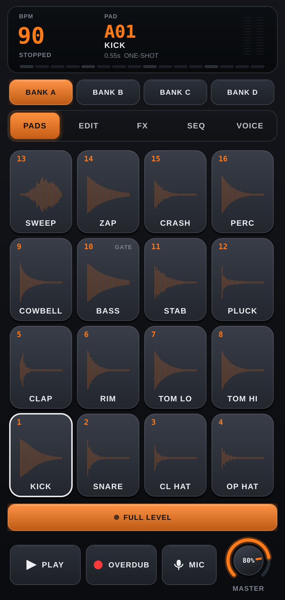
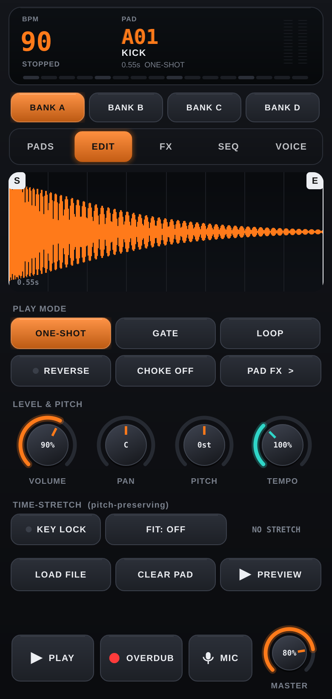
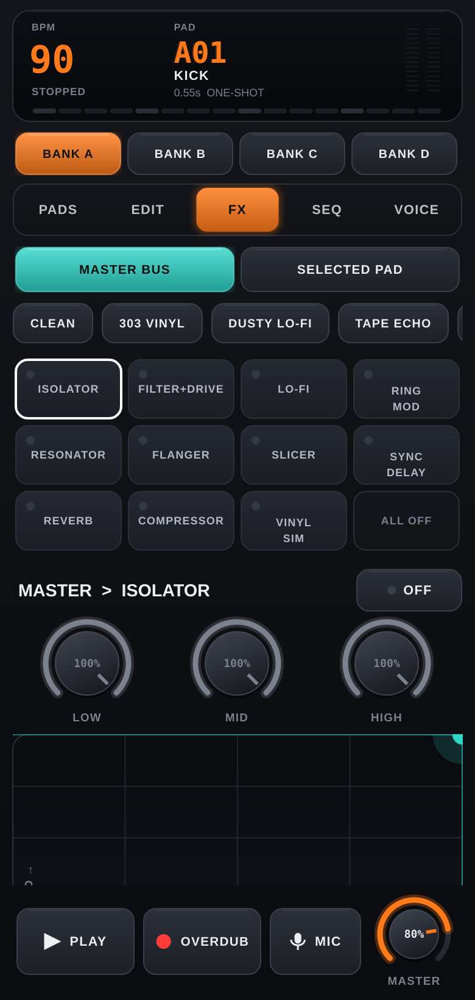
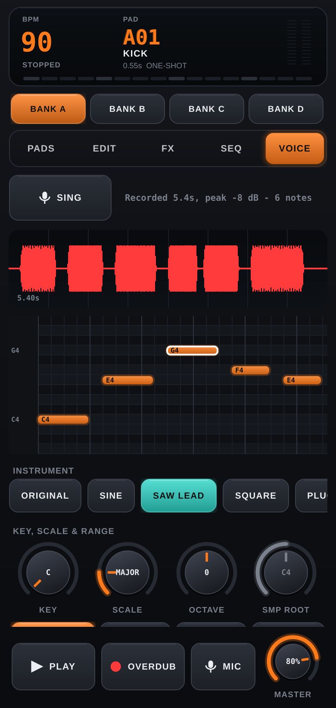

# PadLab 2 — JUCE sampler

MPC-style pad sampler with an SP-303/SP-202-inspired FX rack, per-pad FX, time-stretch and a
sing-a-melody → instrument workflow. C++17 core + [JUCE 8](https://juce.com) UI and audio (Oboe low-latency
path on Android).

| Pads | Edit | FX | Voice |
|---|---|---|---|
|  |  |  |  |

## Layout
- `Source/core/` — pure C++17, **no JUCE**: engine (voices, 16-step sequencer, master + per-pad FX racks), 11 effects,
  WSOLA time-stretch, YIN pitch tracker → notes, 13 offline-rendered instruments, demo kit.
- `Source/ui/`, `Source/*.cpp` — JUCE: custom-drawn widgets (knobs, XY pad, waveform editor with trim handles,
  piano roll, FX tiles), audio device host, file loading, mic capture.
- `tests/CoreTests.cpp` — headless checks for the core (effects, stretch accuracy, pad FX isolation, pitch
  tracking on clean/vibrato/breathy/quiet takes, every instrument) at 44.1 and 48 kHz.
- `PadLab.jucer` — Projucer project used to produce the Android Studio/Gradle project (regenerate with
  `tools/make_jucer.py` after adding source files). `CMakeLists.txt` is the desktop dev build.

## Android APK (built by GitHub Actions)
`.github/workflows/android.yml` clones JUCE, builds Projucer, resaves `PadLab.jucer`, installs NDK 28, runs Gradle and
pushes the signed `padlab-juce/dist/PadLab.apk` back to the branch (also uploaded as a workflow artifact).
It is signed with `debug.keystore` — the same throw-away key as the earlier Java build, package `com.stecaklab.padlab`,
so it installs over that app. arm64-v8a only (practically every phone since 2017).

## Desktop dev build + tests
```bash
git clone --depth 1 --branch 8.0.15 https://github.com/juce-framework/JUCE.git /tmp/JUCE
cmake -S . -B build -G Ninja -DCMAKE_BUILD_TYPE=Release -DJUCE_DIR=/tmp/JUCE
cmake --build build --target CoreTests && ./build/CoreTests           # DSP/pitch/stretch checks
cmake --build build --target PadLab
xvfb-run -a ./build/PadLab_artefacts/Release/PadLab --shots docs      # renders every tab to PNG
```

## License note
JUCE is dual-licensed (AGPLv3 or commercial). This project uses it under AGPLv3, so anyone you give the APK to is
entitled to the source (it is in this repo), and the "Made with JUCE" splash stays unless you buy a JUCE licence.
